<div align="center">


# 🛡️ Hybrid Classical-Quantum Secure Messaging Prototype

**A passphrase-protected chat that seals every message in three layers:**
**plain text → ciphertext 1 → ciphertext 2 → simulated qubits, all carried over HTTPS**

<br/>


<br/>

> *"Even if one algorithm faces a vulnerability, the data remains protected behind the second layer."*

<br/>

[Overview](#-1-project-overview) ·
[Architecture](#-4-system-architecture) ·
[Three Layers](#-5-the-three-layers-of-protection) ·
[Message Journey](#-11-the-complete-message-journey) ·
[Threat Model](#-27-threat-model) ·
[Run It](#-37-running-locally) ·
[Deploy](#-38-deploying-to-vercel)

</div>

---

## 📖 Table of Contents

| # | Section | # | Section |
|---|---------|---|---------|
| 1 | [Project Overview](#-1-project-overview) | 21 | [HTTP Polling vs WebSocket](#-21-http-polling-vs-websocket-delivery) |
| 2 | [What Problem Does It Solve?](#-2-what-problem-does-it-solve) | 22 | [Persistence and Storage](#-22-persistence-and-storage-choices) |
| 3 | [Key Features](#-3-key-features) | 23 | [The Desktop Path](#-23-the-separate-desktop-path) |
| 4 | [System Architecture](#-4-system-architecture) | 24 | [Workflow Across the Internet](#-24-workflow-across-the-internet) |
| 5 | [The Three Layers of Protection](#-5-the-three-layers-of-protection) | 25 | [Single-Layer Systems in Real Life](#-25-single-layer-systems-in-real-life) |
| 6 | [Layer 1: Plain Text to Ciphertext 1](#-6-layer-1-plain-text-to-ciphertext-1) | 26 | [Why Vercel?](#-26-why-vercel-to-publish) |
| 7 | [Layer 2: Ciphertext 1 to Ciphertext 2](#-7-layer-2-ciphertext-1-to-ciphertext-2) | 27 | [Threat Model](#-27-threat-model) |
| 8 | [Layer 3: Ciphertext 2 to Qubits](#-8-layer-3-ciphertext-2-to-qubits-simulated) | 28 | [Man-in-the-Middle Attacks](#-28-man-in-the-middle-attacks) |
| 9 | [HTTPS Carrier and Why Layering Matters](#-9-https-and-tls-the-carrier-and-why-layering-matters) | 29 | [Keyloggers and Endpoints](#-29-keyloggers-and-endpoint-threats) |
| 10 | [Understanding Qubits](#-10-understanding-qubits-and-simulating-them) | 30 | [Custom Input Fields](#-30-custom-input-fields-and-virtual-keyboards) |
| 11 | [The Complete Message Journey](#-11-the-complete-message-journey) | 31 | [Clearing Memory](#-31-clearing-sensitive-data-from-memory) |
| 12 | [Rooms, Passphrases, Participants](#-12-rooms-passphrases-and-participants) | 32 | [Cost of a Data Breach](#-32-statistics-the-cost-of-a-data-breach) |
| 13 | [Socket Handler Behaviour](#-13-socket-handler-behaviour) | 33 | [Security Posture Summary](#-33-security-posture-summary) |
| 14 | [The Flask Send Endpoint](#-14-the-flask-send-endpoint) | 34 | [Honest Limitations](#-34-honest-limitations) |
| 15 | [Server Validation Rules](#-15-validation-rules-on-the-server) | 35 | [Project Structure](#-35-suggested-project-structure) |
| 16 | [Browser Behaviour After Send](#-16-how-the-browser-reacts-after-sending) | 36 | [Configuration Reference](#-36-configuration-reference) |
| 17 | [Message IDs and Ordering](#-17-message-ids-and-ordering) | 37 | [Running Locally](#-37-running-locally) |
| 18 | [The Storage Abstraction](#-18-the-storage-abstraction-room_storepy) | 38 | [Deploying to Vercel](#-38-deploying-to-vercel) |
| 19 | [Fetching with `since`](#-19-fetching-messages-with-the-since-cursor) | 39 | [API Reference](#-39-api-reference) |
| 20 | [Ordered Display](#-20-ordered-display-in-the-browser) | 40 | [FAQ, Glossary, Roadmap](#-40-faq) |

---

## 🌟 1. Project Overview

**Hybrid Classical-Quantum Secure Messaging Prototype** is a prototype chat application. It combines:

- a **Flask web interface** that people use in the browser,
- **passphrase-protected rooms**,
- **participant tracking** so the system knows who is inside a room,
- and a **separate desktop client** that carries its own encryption and decryption environment.

The idea at the centre of the project is simple to say and interesting to build:

> Do not trust a single lock. Put the message behind **three** of them.

Every message that leaves a sender passes through three layers of protection, then travels over HTTPS:

| Layer | Name | What happens | Where it lives |
|:-----:|------|--------------|----------------|
| **1** | Classical encryption | Plain text becomes **ciphertext** | Application layer |
| **2** | Quantum-simulated encoding | Ciphertext becomes **zeros and ones**, represented as simulated qubits | Application layer |
| **3** | Transport security | The result travels inside **HTTPS / TLS** | Network transport |

The word **hybrid** in the name is deliberate. Classical cryptography, a simulated quantum representation, and standard internet transport security are all combined into one pipeline. No single layer is asked to carry the whole burden.

### 🧭 What this README gives you

This document explains the entire project from the ground up:

1. what each layer does and why it exists,
2. how a message travels from one keyboard to another screen,
3. how rooms and passphrases are checked,
4. how the server stores and orders messages,
5. why the web path uses **HTTP polling** rather than WebSockets,
6. what the separate desktop path does,
7. how the data moves across the internet, layer by layer,
8. what attacks exist and how the design answers them,
9. why the project is published on Vercel,
10. and, just as important, **what this prototype does not claim to do**.

---

## 🎯 2. What Problem Does It Solve?

Most chat systems rely on **one** protective measure. Some lean only on transport security. Others lean only on end-to-end encryption. If that single measure has a flaw, the whole conversation is exposed.

This project explores a different posture: **defence in depth**.

### The weakness of a single layer

- If the only protection is TLS, the message is readable by the server and by anything that can see inside the TLS session endpoint.
- If the only protection is one cipher, a flaw in that cipher exposes everything.
- If the only protection is a passphrase, a stolen passphrase opens the room.

### The answer used here

- **Three application-level transformations** (two ciphers, then a qubit simulation) are applied before the message ever reaches the network.
- **HTTPS / TLS** then carries the result, in transit.
- The server checks that a **room exists** and that the **required fields are present** before accepting anything.
- Messages carry an **ID**, so order is stable and no message is silently reordered.

The goal is a clear, teachable demonstration of layered security that a student, a reviewer or a curious developer can read, run and reason about.

---

## ✨ 3. Key Features

<table>
<tr>
<td width="50%" valign="top">

### 🔐 Security

- Three-layer protection per message
- Plain text → Ciphertext 1 as the first layer
- Ciphertext 1 → Ciphertext 2 (a different algorithm) as the second layer
- Ciphertext 2 → simulated qubits (superposition + entanglement) as the third layer
- HTTPS with native Transport Layer Security as the third layer
- Passphrase-protected rooms
- Server-side presence and field checks
- Guidance for keylogger resistance
- Immediate clearing of sensitive data from memory

</td>
<td width="50%" valign="top">

### 💬 Messaging

- Flask-powered web chat interface
- Room-based conversations
- Participant tracking
- Server-assigned message IDs
- Cursor-based fetching with `since`
- Ordered rendering in the browser
- Input cleared only after the server accepts
- Same display flow for sender and all other members

</td>
</tr>
<tr>
<td width="50%" valign="top">

### 🧰 Engineering

- `room_store.py` storage abstraction
- Shared Upstash / Vercel KV when configured
- In-process memory for local development
- Serverless-friendly request model
- Short-lived, stateless, re-authenticated requests

</td>
<td width="50%" valign="top">

### 🖥️ Two Paths

- **Web path:** browser ⇄ Flask over HTTPS polling
- **Desktop path:** `client.py` ⇄ `server.py` over TCP sockets
- Each path has its own encryption and quantum-simulation code
- The desktop path is distinct from the Flask web flow

</td>
</tr>
</table>

---

## 🏗️ 4. System Architecture

The project has two independent delivery paths that share the same *idea* but not the same code.

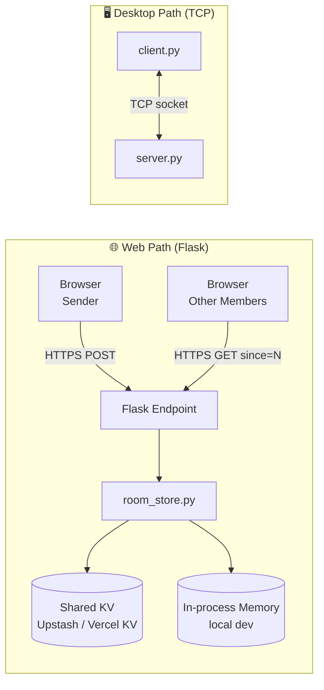

### Component map

| Component | Role |
|-----------|------|
| **Browser UI** | Collects the message, runs the first steps, posts to the Flask endpoint, polls for new messages |
| **Socket handler** | Reads the input and checks that the user joined the room |
| **Flask endpoint** | Receives the HTTP request, validates it, stores it |
| **`room_store.py`** | Abstraction that writes to shared Upstash / Vercel KV or to in-process memory |
| **Message ID** | Gives every stored message a position in the order |
| **`client.py` / `server.py`** | Desktop path using TCP sockets with their own encryption and quantum simulation |
| **Vercel** | Publishes the web path as serverless functions |

### Two paths, one philosophy

The Flask web flow and the desktop TCP flow are **different programs**. They do not share a runtime. What they share is the philosophy: encrypt, encode, then transport. Anyone studying the code should treat them as two separate implementations of the same security story.

---

## 🧱 5. The Three Layers of Protection

The three layers are three **successive transformations** of the message:

| Layer | Transformation | Nature |
|:-----:|----------------|--------|
| **1** | **Plain text → Ciphertext 1** | First encryption |
| **2** | **Ciphertext 1 → Ciphertext 2** | Second encryption, using a *different* algorithm |
| **3** | **Ciphertext 2 → Qubits** | Simulated environment with **superposition** and **entanglement** |

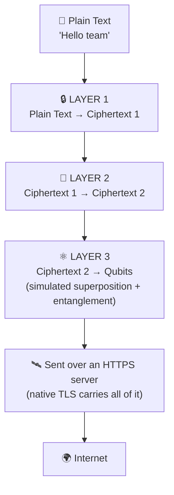

Think of it as three nested envelopes, each one sealing the one before it:

1. **Envelope 1:** the plain text is sealed into Ciphertext 1.
2. **Envelope 2:** Ciphertext 1 is sealed again into Ciphertext 2.
3. **Envelope 3:** Ciphertext 2 is converted into qubit form, inside a simulated environment built to behave with superposition and entanglement.

The finished package is then **transmitted through an HTTPS server**. HTTPS is the *road* the three layers travel on. It uses **native Transport Layer Security** to keep the data's **integrity** and **confidentiality** during transit. It is the carrier, not one of the three message layers.

| Property | Layer 1 | Layer 2 | Layer 3 | HTTPS / TLS (carrier) |
|----------|:-------:|:-------:|:-------:|:---------------------:|
| Hides the content | ✅ | ✅ | ✅ | ✅ |
| Different algorithm from the one before | – | ✅ | ✅ | – |
| Protects the data if the layer below it fails | – | ✅ | ✅ | – |
| Integrity in transit | – | – | – | ✅ |
| Applied by the application | ✅ | ✅ | ✅ | – |

---

## 🔒 6. Layer 1: Plain Text to Ciphertext 1

**This is the first layer of encryption.**

```
 plain text   ─────────────►   ciphertext 1
 "Hello"             encrypt        "x9Q…=="
```

After the user types a message, the first thing the system does is encrypt it. Plain text never needs to travel anywhere in readable form. Once the message is Ciphertext 1, the next layer works on it.

### Why a classical layer first?

- Classical cryptography is well understood.
- It gives a solid, standard base that the later layers build on.
- Its output is already unreadable without the key.

### What Layer 1 must guarantee

| Requirement | Meaning |
|-------------|---------|
| Output is unreadable | Ciphertext 1 does not reveal the plain text |
| Output is reversible | The intended receiver can undo it |
| Independent of Layer 2 | A flaw in Layer 2 does not undo Layer 1 |
| Independent of Layer 3 | A flaw in the qubit simulation does not expose plain text |

---

## 🔐 7. Layer 2: Ciphertext 1 to Ciphertext 2

**This is the second layer of encryption.** Ciphertext 1 is encrypted again:

```
 ciphertext 1   ─────────────►   ciphertext 2
   "x9Q…=="            encrypt         "Zm4…=="
```

### Two different asymmetric algorithms, in sequence

The project's approach relies on using **two different asymmetric algorithms in sequence**:

> By using two different asymmetric algorithms in sequence, you can ensure that even if one algorithm faces a vulnerability, the data remains protected behind the second layer.

| | Layer 1 | Layer 2 |
|--|---------|---------|
| Algorithm | Asymmetric algorithm **A** | A **different** asymmetric algorithm **B** |
| Input | Plain text | Ciphertext 1 |
| Output | Ciphertext 1 | Ciphertext 2 |

If both layers used the same algorithm, one discovered weakness would break both at once. Two different mathematical foundations mean a single breakthrough does not unlock the message.

### Where it happens in the web flow

The flow notes say that after Flask **checks and stores** the request, and confirms **required fields exist** and the **room exists**, **it does the second layer of encryption**. Layer 2 is applied on the server path, after validation succeeds.

---

## ⚛️ 8. Layer 3: Ciphertext 2 to Qubits (Simulated)

**This is the third layer.** The final ciphertext, Ciphertext 2, is converted into **qubits**:

```
 ciphertext 2   ─────────────►   qubits  (simulated)
```

### A simulated environment

A real qubit uses **superposition** and **entanglement**, so data can represent **zeros and ones simultaneously**. A normal computer cannot hold a real qubit. So this layer works by **creating an environment that simulates** those behaviours using classical bits:

| Quantum idea | What the simulated environment does |
|--------------|-------------------------------------|
| **Superposition** | Each simulated qubit carries a blend of 0 and 1 rather than one fixed value, until it is "measured" (read back) |
| **Entanglement** | Simulated qubits are linked, so the state of one depends on the state of others in the register |
| **Zeros and ones simultaneously** | The data is held as a register of linked, blended states instead of a plain bit string |

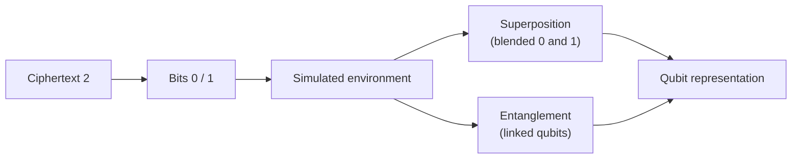

### Illustration

```
ciphertext 2 bytes  →  bit string      →  simulated qubit register
  0x9F 0x2A             1001 1111          |ψ₀⟩ ⟷ |ψ₁⟩ ⟷ |ψ₂⟩ ⟷ |ψ₃⟩ …
                        0010 1010          (each |ψ⟩ = α|0⟩ + β|1⟩, linked to its neighbours)
```

> 📌 **Note:** It is very practical to simulate quantum qubits using classical bits for demonstration purposes.

See [Honest Limitations](#-34-honest-limitations) for what this does and does not buy you.

---

## 🛰️ 9. HTTPS and TLS: The Carrier, and Why Layering Matters

### Transmission over HTTPS

The result of the three layers is **transmitted via an HTTPS server**, which uses **native Transport Layer Security**. TLS keeps:

- **Integrity** of the data during transit, so tampering is detected.
- **Confidentiality** of the data during transit, so eavesdroppers see only encrypted traffic.
- **Server authentication**, so the browser knows it is talking to the real server.

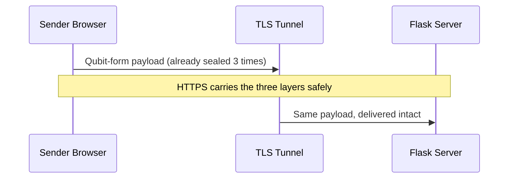

### Why the layering matters

> The double encryption process added a significant layer of security to the project's approach.

| Situation | Single protection | Layered (this project) |
|-----------|-------------------|------------------------|
| One algorithm is found vulnerable | Everything exposed | The second cipher still protects the data |
| Transport is misconfigured | Plain text may leak | Content is still Ciphertext 2 in qubit form |
| A server logs a payload | Readable if only TLS was used | Unreadable without undoing every layer |
| A middlebox inspects traffic | Sees content if TLS is stripped | Sees only qubit-encoded ciphertext |

### What layering is **not**

- It is not a promise that nothing can go wrong.
- It does not defend against malware on the user's own device. See [Keyloggers and Endpoint Threats](#-29-keyloggers-and-endpoint-threats).
- It does not make a weak passphrase strong.

---

## 🔬 10. Understanding Qubits (and Simulating Them)

### Classical bit vs qubit

| | Classical bit | Qubit |
|--|---------------|-------|
| Possible values | `0` **or** `1` | `0`, `1`, or a blend of both |
| Key properties | Definite state | **Superposition**, **entanglement** |
| Hardware | Any computer | Specialised quantum hardware |
| Copying | Trivial | Restricted by physics |

### The two ideas the project borrows

**Superposition** means a qubit can represent zero and one *at the same time* until it is measured.

**Entanglement** means two or more qubits can be linked so the state of one is tied to the state of another.

The project's wording: the data *can represent zeros and ones simultaneously*.

### Simulation, not hardware

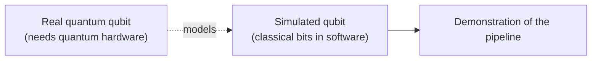

A simulated qubit is a classical data structure that **behaves like** a qubit in the demonstration. This is why the project can honestly be called a **prototype**: it shows the shape of a hybrid classical-quantum messaging system without requiring a quantum computer.

### Why simulate at all?

1. **Accessibility** – anyone can run it.
2. **Education** – the concept becomes visible and testable.
3. **Architecture practice** – the slot where a real quantum layer would sit is already built.
4. **Honesty** – the README states plainly what is simulated.

---

## 🚀 11. The Complete Message Journey

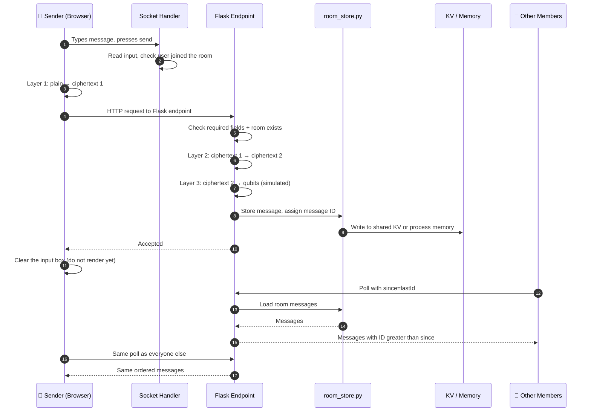

### Step by step

| Step | Actor | Action |
|:----:|-------|--------|
| 1 | Socket handler | Reads the input and checks that the user **joined the room** |
| 2 | Browser | Sends an **HTTP request to the Flask endpoint** |
| 3 | Layer 1 | **Plain → Ciphertext 1** is done |
| 4 | Flask | **Checks and stores** the request |
| 5 | Flask | Confirms **required fields exist** and the **room exists** |
| 6 | Layers 2 + 3 | **Ciphertext 1 → Ciphertext 2 → qubits** (quantum simulated) |
| 7 | Server | If it **accepts** the message, the browser **clears the input** |
| 8 | Browser | Does **not** immediately add the message to the chat display |
| 9 | Store | The **message ID** gives stored messages an order |
| 10 | Flask route | Loads the room's messages and returns those whose ID is **greater than `since`** |
| 11 | Browser | Displays messages **in order** |

### The rule that keeps everyone consistent

> We should make sure that **sender and other room members use the same display flow**. This really makes sense, you know.

The sender does not get a privileged shortcut. The sender's own message appears **only after** it comes back through the same polling path every other member uses. That guarantees everybody sees the same list in the same order, and it proves that what is on screen has really been stored by the server.

---

## 🚪 12. Rooms, Passphrases and Participants

The application is organised around **rooms**.

### Room concept

- A room is a named space where participants exchange messages.
- A room is **passphrase-protected**.
- The system performs **participant tracking**, so it knows who has joined.

### Join flow

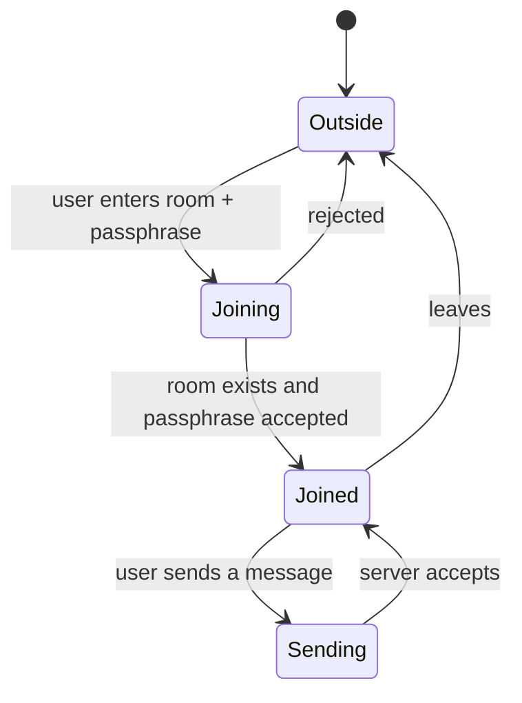

### What "joined" means

A user must have **joined the room** before a message from them is acted upon. The socket handler reads the input and checks exactly that. A message from someone who never joined is not stored.

### Participant tracking

| Tracked item | Why it matters |
|--------------|----------------|
| Who is in the room | Messages are only valid from members |
| Room existence | The server refuses messages for rooms that do not exist |
| Passphrase gate | Only people who know the passphrase can enter |

### Passphrase hygiene

- Choose long, unique passphrases.
- Share them through a different channel than the chat.
- Do not reuse a passphrase between rooms.
- Never type a passphrase on a machine you suspect is compromised. See the [keylogger section](#-29-keyloggers-and-endpoint-threats).

---

## 🔌 13. Socket Handler Behaviour

The socket handler is the first gatekeeper in the web flow.

**Its job:**

1. **Read the input** the user submitted.
2. **Check that the user joined the room.**
3. Pass the request on only if both are satisfied.

```text
incoming input
      │
      ▼
┌───────────────────────┐
│  read input           │
└──────────┬────────────┘
           ▼
┌───────────────────────┐   no    ┌───────────────┐
│  user joined room ?   ├────────►│  reject       │
└──────────┬────────────┘         └───────────────┘
           │ yes
           ▼
   continue to Flask endpoint
```

This is a deliberately small responsibility. It does not store, it does not encrypt on behalf of the server, and it does not order messages. It reads and verifies membership.

---

## 📮 14. The Flask Send Endpoint

After the first layer of encryption is done, the browser **sends an HTTP request to the Flask endpoint**.

### What Flask does, in order

| # | Responsibility | Detail |
|:-:|----------------|--------|
| 1 | Receive | Accept the HTTP request from the browser |
| 2 | Check and store | Examine the request and prepare to store it |
| 3 | Field check | Verify that **required fields exist** |
| 4 | Room check | Verify that the **room exists** |
| 5 | Second layer | Perform **Ciphertext 1 → Ciphertext 2**, then **Ciphertext 2 → qubits** (simulated) |
| 6 | Persist | Hand the result to `room_store.py` |
| 7 | Respond | Tell the browser whether the message was accepted |

### Sample request shape

```http
POST /api/send HTTP/1.1
Host: your-app.vercel.app
Content-Type: application/json

{
  "room": "alpha-team",
  "sender": "alice",
  "payload": "<layer-1 ciphertext>"
}
```

### Sample response shapes

```json
{ "ok": true, "id": 42 }
```

```json
{ "ok": false, "error": "room_not_found" }
```

> The paths and field names above illustrate the shape of the exchange. Adjust them to match your actual routes.

---

## ✅ 15. Validation Rules on the Server

The server never trusts the browser. Before anything is stored it checks:

| Rule | Failure result |
|------|----------------|
| Required fields are present | Request rejected |
| Room exists | Request rejected |
| Sender has joined the room | Request rejected |
| Payload is not empty | Request rejected |

### Why validate on the server when the browser already checked?

Because the browser is under the user's control, and therefore under an attacker's control if the user is an attacker. Any check done only in the browser is a suggestion. Only the server's check is a rule.

### Order matters

Validation happens **before** the second and third layers are applied. There is no value in encoding and storing something that is going to be refused.

---

## 🖱️ 16. How the Browser Reacts After Sending

Two behaviours are worth stating clearly:

1. **If the server accepts the message, the browser clears the input.**
2. **It does not immediately add the message to the chat display.**

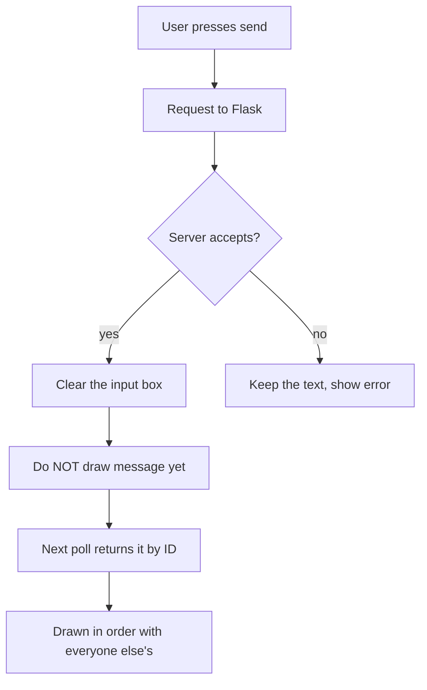

### Why not draw it immediately?

- It prevents a **ghost message** that appears on screen but was never stored.
- It keeps the **sender's view identical** to every other member's view.
- It removes a whole class of ordering bugs, because there is only one path that puts messages on screen.

Clearing the input on acceptance has a second benefit for security: plain text does not linger in the input field any longer than it must. This links directly to [Clearing Sensitive Data from Memory](#-31-clearing-sensitive-data-from-memory).

---

## 🔢 17. Message IDs and Ordering

> The message ID gives stored messages an order.

### How it works

- Every accepted message receives an **ID**.
- IDs increase, so a larger ID means a later message.
- The ID is the **single source of truth** for order. Not the clock in the browser. Not the arrival time at the screen.

```text
room "alpha-team"
┌────┬─────────┬──────────────────────┐
│ ID │ sender  │ stored payload       │
├────┼─────────┼──────────────────────┤
│ 40 │ alice   │ 10010111…            │
│ 41 │ bob     │ 01101001…            │
│ 42 │ alice   │ 11100010…            │
└────┴─────────┴──────────────────────┘
```

### Why not use timestamps?

Devices disagree about the time. Two messages sent in the same second can tie. An ID assigned in one place has none of those problems.

---

## 🗄️ 18. The Storage Abstraction (`room_store.py`)

> The abstraction in `room_store.py` writes to **shared Upstash / Vercel KV when configured**, or to **in-process memory for local development**.

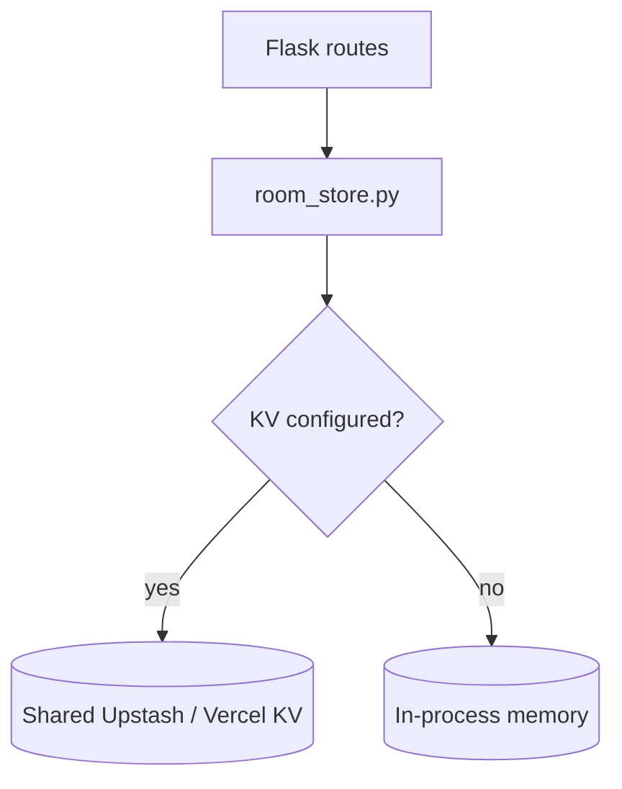

### Why an abstraction?

The Flask routes should not care *where* messages live. They call the same functions either way:

| Operation | Purpose |
|-----------|---------|
| Add message | Store a new message and return its ID |
| Load room messages | Return the messages of a room |
| Room exists | Used by validation |

### Choice of backend

| | In-process memory | Shared KV (Upstash / Vercel KV) |
|--|:-----------------:|:-------------------------------:|
| Setup | None | Needs credentials |
| Good for | Local development | Deployment |
| Survives restart | ❌ | ✅ |
| Shared across server instances | ❌ | ✅ |
| Works with multiple serverless instances | ❌ | ✅ |

---

## 🔍 19. Fetching Messages with the `since` Cursor

> Flask's route loads the room's messages and returns those whose IDs are **greater than `since`**.

```http
GET /api/messages?room=alpha-team&since=41
```

```json
{
  "messages": [
    { "id": 42, "sender": "alice", "payload": "11100010…" }
  ]
}
```

### The cursor idea

- The browser remembers the **highest ID it has seen**.
- It sends that number as `since`.
- The server returns **only newer messages**.
- The browser updates its cursor and asks again later.

This keeps each poll small and cheap, and it means a browser that was offline can catch up simply by asking from its last known ID.

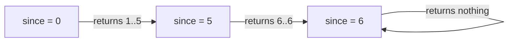

---

## 📋 20. Ordered Display in the Browser

> We make sure the browser displays messages in order by the above one.

The browser:

1. Receives messages returned for `since`.
2. **Sorts / places them by message ID.**
3. Appends them to the chat display in that order.
4. Skips anything it has already shown.

### Guarantees

| Guarantee | How |
|-----------|-----|
| No reordering | Display order = ID order |
| No duplicates | Cursor moves past IDs already shown |
| Same view for everyone | Same ID-based rule for sender and members |

---

## 📡 21. HTTP Polling vs WebSocket Delivery

> ⭐ **Important:** This is **HTTP polling**, not WebSocket delivery.

### Why HTTP polling instead of WebSocket delivery?

Both HTTP and WebSockets **can** be secure, provided they use encryption (**HTTPS / WSS**) and proper authentication. However, **HTTP polling often has a smaller attack surface**, because each request is **short-lived, stateless, and re-authenticated**. WebSockets maintain a **long-lived, stateful connection** that requires careful **resource and session management**.

### Side by side

| Aspect | HTTP polling (this project) | WebSocket |
|--------|-----------------------------|-----------|
| Connection life | Short-lived | Long-lived |
| State on server | Stateless | Stateful |
| Authentication | Re-authenticated per request | Typically at connection time |
| Secure channel | HTTPS | WSS |
| Attack surface | Smaller | Larger, needs careful management |
| Resource management | Simple | Needs careful resource + session handling |
| Fit with serverless | Excellent | Awkward |

### The trade-off, stated honestly

Polling is slightly less instant and sends more small requests. For a prototype that prizes a small attack surface and serverless hosting, that is a good trade.

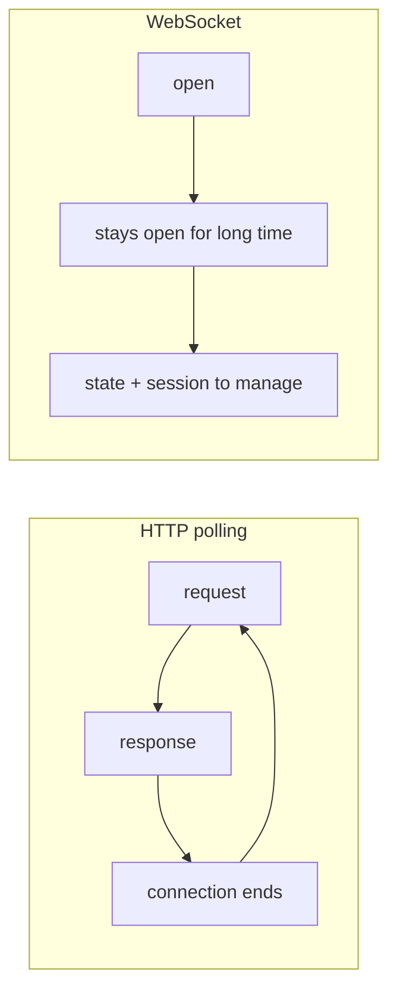

---

## 💾 22. Persistence and Storage Choices

> The current storage choice affects persistence.

### Local in-memory storage

- Suitable for **development**.
- Data can **disappear on restart**.
- It is **not shared across separate server instances**.

### Shared KV storage

- **Needed for a multi-instance deployment.**
- Every instance reads and writes the same data.
- Messages survive restarts.

### Decision guide

| Your situation | Use |
|----------------|-----|
| Trying it on your laptop | In-process memory |
| Running a demo on Vercel | Shared KV |
| More than one server instance | Shared KV (required) |
| Need messages to survive restarts | Shared KV |

> ⚠️ On a serverless platform, separate invocations may land on separate instances. In-memory storage there will look like it "loses" messages. That is not a bug in the chat logic; it is the storage choice showing through.

---

## 🖥️ 23. The Separate Desktop Path

> This project has a **separate desktop path**.

`client.py` and `server.py` use **TCP sockets** and contain their **own encryption and quantum-simulation code**. This is **distinct from the Flask web flow**.

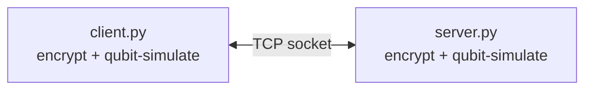

### Differences from the web path

| | Web path | Desktop path |
|--|----------|--------------|
| Entry | Browser | `client.py` |
| Server | Flask | `server.py` |
| Transport | HTTPS polling | TCP sockets |
| Storage | `room_store.py` (KV / memory) | Handled by the desktop server |
| Crypto code | Web flow | Own code inside client and server |

### Why keep them separate?

It allows experimentation with each approach independently. A reader can study the persistent-socket model on the desktop and the stateless polling model on the web, side by side.

---

## 🌍 24. Workflow Across the Internet

The journey of one message through the network stack:

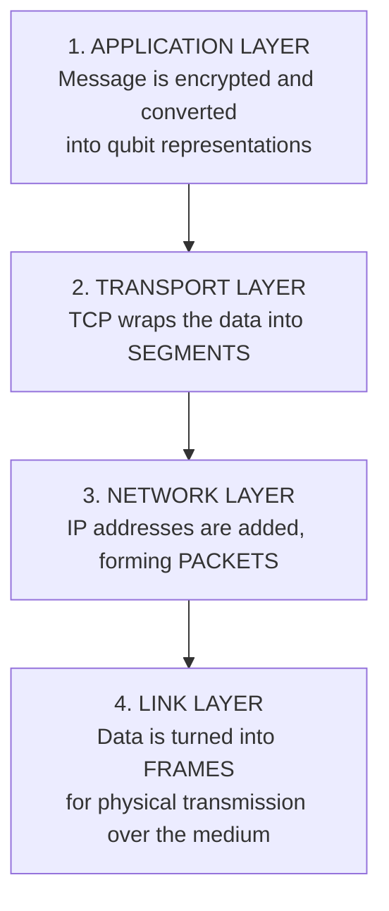

| Layer | What happens | Unit of data |
|-------|--------------|:------------:|
| Application | Your message is **encrypted and converted into qubit representations** | Message |
| Transport | **TCP wraps** the data into segments | Segments |
| Network | The network layer **adds IP addresses**, forming packets | Packets |
| Link | Data is **turned into frames** for physical transmission over the medium | Frames |

### On the server side, the process reverses

Frames become packets, packets become segments, and segments are reassembled.

- **TCP segments** ensure **reliable delivery**, managing **sequencing and packet loss**.
- **HTTPS pooling** then allows **multiple requests to share an existing TLS connection** (Transport Layer Security).

```text
SENDER                                                     RECEIVER
Application  ─ encrypted + qubit form ─────────────►  Application
Transport    ─ TCP segments ───────────────────────►  Transport (sequencing, loss handling)
Network      ─ IP packets ─────────────────────────►  Network
Link         ─ frames over the medium ─────────────►  Link
```

### Why this matters for security

By the time the data reaches the lower layers, the content is **already protected at the application layer**. Routers and switches along the way only ever handle ciphertext in qubit form, wrapped inside TLS.

---

## 🧩 25. Single-Layer Systems in Real Life

Many well-known systems rely on **one** primary protective approach. Seeing them clearly shows what this project does differently.

| System | Primary approach | Notes |
|--------|------------------|-------|
| **Standard Telegram chats** | **Server-side encryption**, where the service provider holds the ability to read | Protection mainly guards data on the provider's side |
| **Many legacy communication systems** | **Transport Layer Security** only, with **no application-level encryption** for the data itself | Data is plain at the endpoints of the TLS session |
| **WhatsApp** | **End-to-end encryption via the Signal protocol**, acting as a **single primary cryptographic layer** for securing message content device to device | Strong, but still one main layer |

### What this project adds

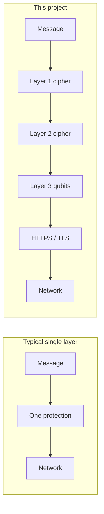

The point is not to say those platforms are weak. It is to show that **adding independent layers** is a design choice that raises the effort an attacker must spend.

---

## ☁️ 26. Why Vercel to Publish?

**Vercel specialises in frontend frameworks and serverless functions**, which is **ideal for the HTTP transmission used in our client-server model.**

### Reasons

| Reason | Explanation |
|--------|-------------|
| Fits the model | The web path is plain HTTP request / response, a natural fit for serverless functions |
| Scalable | **Serverless functions are highly scalable** |
| Cost-effective | **Cost-effective for unpredictable traffic**, since you pay for use |
| No server chores | **We don't manage servers** |
| HTTPS by default | Published sites are served over HTTPS, supporting the HTTPS carrier |
| Easy deployment | Publish from a repository with minimal setup |

### The link back to polling

HTTP polling and serverless functions suit each other. Each poll is a short invocation that starts, answers and ends. A long-lived WebSocket does not fit that model. This is part of why [polling was chosen](#-21-http-polling-vs-websocket-delivery).

### The link back to storage

Serverless invocations can run on different instances. That is exactly why **shared KV storage is needed** for a multi-instance deployment.

---

## 💰 27. Threat Model

> **Attack types and how to overcome them.**

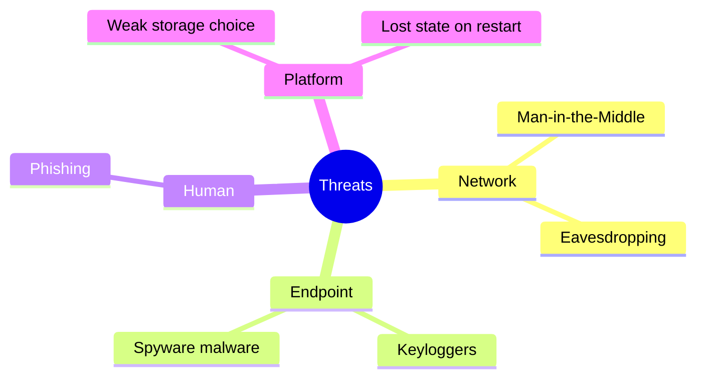

### Summary table

| Attack | What it does | Primary defence in this project |
|--------|--------------|----------------------------------|
| **Man-in-the-middle** | Intercepts data while it is being transmitted and captures it | All transmission over **secured HTTPS** + data already double-encrypted |
| **Keylogger** | Records keystrokes **before** encryption and **after** decryption | **Virtual keyboard / custom input fields** + **clear sensitive data from memory** |
| **Phishing** | Tricks a person into giving away secrets | Awareness, passphrase hygiene, verify the site address |

### The ordering insight

Network defences protect data **between** devices. Keyloggers attack **at** the device. That is why the notes call keyloggers the most important thing to consider: encryption cannot protect what is captured before it is encrypted.

---

## 🕵️ 28. Man-in-the-Middle Attacks

**Common attack: man-in-the-middle (MITM).**

- It **intercepts** data **while it is being transmitted** and **captures** it.

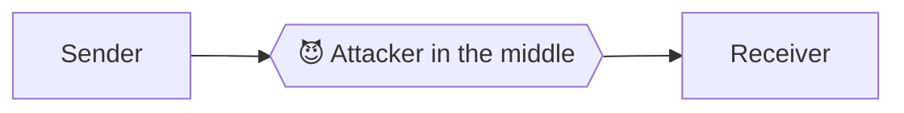

### How the project answers it

1. **All transmission is done using secured HTTPS** (the carrier).
2. Even if the TLS protection were somehow defeated, what the attacker captures is **Ciphertext 2 in qubit-simulated form**.
3. The attacker must break **all three layers** to read a message.

| Attacker success so far | What they see |
|------------------------|---------------|
| Watches the network | TLS-encrypted traffic |
| Strips / breaks TLS | Qubit-encoded ciphertext |
| Also undoes Layer 3 (qubits) | Ciphertext 2 |
| Also breaks Layer 2 | Ciphertext 1 |
| Also breaks Layer 1 | Plain text |

### Practical advice

- Only use the HTTPS address of the deployment.
- Do not click through browser certificate warnings.
- Avoid untrusted public networks for sensitive rooms.

---

## ⌨️ 29. Keyloggers and Endpoint Threats

**Common attack: end-point threats like keyloggers**, which record **keystrokes before encryption and decryption.**

### What is a keylogger?

> A **keylogger** is a **spyware / malware** designed to **secretly record every keystroke** made on a computer or mobile device, **specifically to capture sensitive data as it's typed.**

### Why it is the hardest case

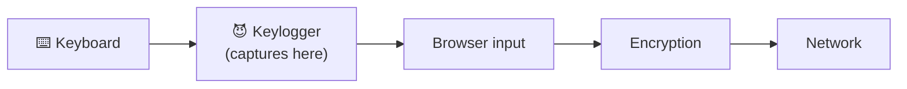

Encryption starts **after** the keys are pressed. A keylogger records at the keyboard, ahead of every layer in this project. Network-side protection cannot help here, so a different kind of defence is needed.

### Defences in this project's design

| Defence | Purpose |
|---------|---------|
| **Implement a virtual keyboard** | Typing does not go through the usual physical-key path |
| **Use custom input fields** | Keystrokes are handled in memory rather than via standard tags |
| **Clear sensitive data from memory immediately after use** | Shortens the time anything sensitive exists |
| **Secured HTTPS for all transmission** | Covers the in-transit side |

---

## 🧪 30. Custom Input Fields and Virtual Keyboards

### What is meant by custom input fields?

**Instead of using standard HTML input tags**, where **malware can easily hook into the data**, **custom fields use JavaScript listeners to process keystrokes in memory.**

Once they are **encrypted or decrypted, or transmitted directly**, that **bypasses the operating system's standard input tracking.**

### How custom input fields work

> Custom input fields work by **abstracting the typing process away from the standard browser input mechanisms.**

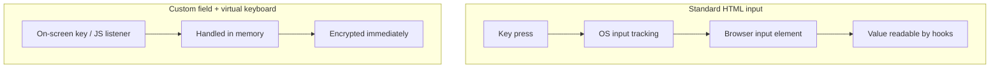

### Comparison

| | Standard `<input>` | Custom field / virtual keyboard |
|--|--------------------|----------------------------------|
| Where the keystroke is processed | Through the normal input path | In memory by JavaScript listeners |
| Easy for malware to hook | Yes | Harder |
| Passes through OS standard input tracking | Yes | Bypassed |
| Complexity | Low | Higher |

### In a word

Custom input fields **move the moment of typing out of the place where malware is watching**.

### A sketch of the idea

```javascript
// Conceptual illustration only: keystrokes are collected in a closure,
// never placed in a standard <input> value, and wiped after use.
const buffer = [];

document.addEventListener("keydown", (e) => {
  if (e.key.length === 1) buffer.push(e.key);
  if (e.key === "Backspace") buffer.pop();
  e.preventDefault();
});

function takeAndWipe() {
  const text = buffer.join("");
  buffer.length = 0;            // clear immediately after use
  return text;
}
```

> Virtual keyboards and custom fields **reduce** exposure. They do not make a fully compromised device safe.

---

## 🧹 31. Clearing Sensitive Data from Memory

> **Note:** Make sure to **clear sensitive data from memory immediately after use.**

### What counts as sensitive?

- Plain text of a message before encryption
- Passphrases
- Keystroke buffers
- Intermediate values created during encryption

### Practices

| Practice | Effect |
|----------|--------|
| Clear the input after the server accepts | Plain text leaves the field |
| Empty keystroke buffers after each send | Nothing left to harvest |
| Drop references to secrets as soon as they are used | Shorter lifetime in memory |
| Do not log plain text or passphrases | Nothing sensitive in logs |

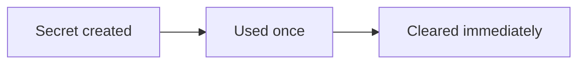

The shorter a secret lives in memory, the smaller the window in which malware or a memory dump can capture it.

---

## 📊 32. Statistics: The Cost of a Data Breach

The following figures come from the project's research notes.

| Scope | Average cost of a data breach |
|-------|-------------------------------|
| 🇮🇳 **India** | **₹28.5 crore** |
| 🌏 **Asia** | approximately **US $3.67 million** |
| 🌐 **Global** | **US $4.99 million** |

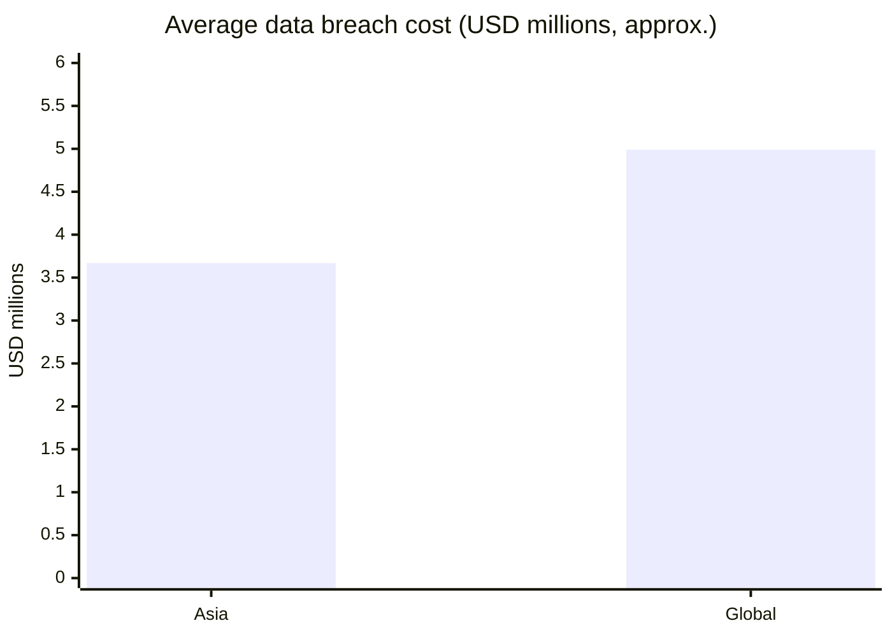

### What drives these costs in the notes

- **Phishing** and **man-in-the-middle attacks** are named as contributors in India.
- **The most important thing is keylogger attacks.**

### Why include this?

Because security work is easier to justify when the price of failure is visible. A prototype that layers its defences is a small investment compared with figures of this size.

> 📝 These numbers vary by report and year. If you reuse them in a paper or presentation, cite the specific report edition you take them from.

---

## 🧾 33. Security Posture Summary

| Threat | Layer 1 | Layer 2 | Layer 3 | Input hardening | Memory clearing |
|--------|:------:|:------:|:------:|:---------------:|:---------------:|
| Network eavesdropping (with HTTPS) | ✅ | ✅ | ✅ | – | – |
| Man-in-the-middle | ✅ | ✅ | ✅ | – | – |
| Flaw in one algorithm | ✅ | ✅ | – | – | – |
| Keylogger | – | – | – | ✅ | ✅ |
| Memory scraping | – | – | – | – | ✅ |
| Non-member sending messages | – | – | – | – | – |

The last row is handled by **server-side membership and room checks**, not by cryptography.

### One-line version

**Content is sealed three times at the application level (two ciphers, then qubits), carried over HTTPS, and the input path is hardened against keystroke capture.**

---

## ⚠️ 34. Honest Limitations

A good prototype is clear about its edges.

1. **Qubits are simulated.** Classical bits stand in for qubits. This shows the architecture; it does not deliver the physical guarantees of real quantum communication.
2. **Simulation is not a cryptographic proof.** Layer 3 adds a structural transformation. Its strength should not be assumed to equal that of a vetted cipher.
3. **Endpoint compromise defeats everything.** If a device is fully compromised, no network design can save it.
4. **In-memory storage is temporary.** Local data can disappear on restart and is not shared across instances.
5. **Polling is not instant.** Messages arrive on the next poll, not the moment they are sent.
6. **Passphrase strength matters.** A weak passphrase weakens the room.
7. **Prototype status.** It has not been through an independent security audit. Do not use it to protect truly sensitive information.
8. **Two paths, two code bases.** The web flow and the desktop flow can drift apart if not maintained together.

> Being straightforward about these points is part of the project's design.

---

## 📁 35. Suggested Project Structure

```text
hybrid-classical-quantum-secure-messaging/
├── app.py                  # Flask application and routes
├── room_store.py           # Storage abstraction (Upstash / Vercel KV or in-memory)
├── requirements.txt        # Python dependencies
├── vercel.json             # Vercel routing and build configuration
├── templates/
│   └── index.html          # Chat interface
├── static/
│   ├── css/
│   │   └── style.css
│   └── js/
│       ├── chat.js         # Polling, ordering, display
│       └── input.js        # Custom input field / virtual keyboard
├── desktop/
│   ├── client.py           # TCP client with its own encryption + qubit simulation
│   └── server.py           # TCP server with its own encryption + qubit simulation
├── docs/
│   └── notes/              # Research notes
└── README.md
```

| File | Responsibility |
|------|----------------|
| `app.py` | Routes: join, send, fetch with `since` |
| `room_store.py` | Pick KV or memory, add / load messages |
| `chat.js` | Poll, keep the cursor, display in ID order |
| `input.js` | Handle typing outside standard inputs |
| `client.py` / `server.py` | The separate desktop path |

---

## ⚙️ 36. Configuration Reference

| Variable | Required | Purpose |
|----------|:--------:|---------|
| `SECRET_KEY` | Recommended | Flask session signing |
| `KV_REST_API_URL` | For shared storage | Upstash / Vercel KV endpoint |
| `KV_REST_API_TOKEN` | For shared storage | Upstash / Vercel KV token |
| `POLL_INTERVAL_MS` | Optional | How often the browser polls |
| `PORT` | Optional | Local server port |

### Storage selection logic

```text
if KV credentials are present   → use shared Upstash / Vercel KV
else                            → use in-process memory (development)
```

Example `.env` for local development:

```bash
SECRET_KEY=change-me
POLL_INTERVAL_MS=1500
# Leave KV_* unset to use in-memory storage
```

Example `.env` for deployment:

```bash
SECRET_KEY=a-long-random-value
KV_REST_API_URL=https://<your-instance>.upstash.io
KV_REST_API_TOKEN=<your-token>
POLL_INTERVAL_MS=1500
```

> Never commit real tokens to the repository.

---

## 🏃 37. Running Locally

### Prerequisites

- Python 3.10 or newer
- `pip`
- A modern browser

### Web path

```bash
git clone https://github.com/<you>/hybrid-classical-quantum-secure-messaging.git
cd hybrid-classical-quantum-secure-messaging

python -m venv .venv
source .venv/bin/activate          # Windows: .venv\Scripts\activate

pip install -r requirements.txt
python app.py
```

Open `http://localhost:5000` in two browser windows, join the same room with the same passphrase, and send a message from one. Watch it appear in both windows through the polling path.

### Desktop path

```bash
# Terminal 1
python desktop/server.py

# Terminal 2 and 3
python desktop/client.py
```

### What to check

| Check | Expected |
|-------|----------|
| Send from window A | Input clears |
| Message in window A | Appears after the next poll, not instantly |
| Message in window B | Appears in the same order |
| Restart the local server | In-memory messages are gone |
| Send to a missing room | Rejected |

---

## 🚢 38. Deploying to Vercel

1. Push the project to a Git repository.
2. Import the repository in [Vercel](https://vercel.com).
3. Add a KV store (Upstash / Vercel KV) and connect it to the project.
4. Set environment variables from the [configuration table](#-36-configuration-reference).
5. Deploy. Vercel serves the site over **HTTPS**, supporting the transport carrier.

Example `vercel.json`:

```json
{
  "version": 2,
  "builds": [{ "src": "app.py", "use": "@vercel/python" }],
  "routes": [{ "src": "/(.*)", "dest": "app.py" }]
}
```

### Deployment checklist

- [ ] KV credentials set, so storage is shared
- [ ] `SECRET_KEY` set to a long random value
- [ ] Only the HTTPS address is shared
- [ ] No secrets committed
- [ ] Two browsers tested end to end against the deployed URL

> Skipping the KV step on Vercel is the most common cause of "missing messages", because separate instances do not share memory.

---

## 📚 39. API Reference

| Method | Path | Purpose |
|:------:|------|---------|
| `POST` | `/api/join` | Join a room with a passphrase |
| `POST` | `/api/send` | Send a message into a room |
| `GET` | `/api/messages?room=…&since=…` | Fetch messages with ID greater than `since` |

*(Paths are illustrative; adapt them to your routes.)*

### Typical errors

| Code | Meaning |
|------|---------|
| `missing_fields` | A required field was not provided |
| `room_not_found` | The room does not exist |
| `not_joined` | The sender has not joined the room |
| `bad_passphrase` | Passphrase did not match |

---

## ❓ 40. FAQ

<details>
<summary><b>Is this real quantum encryption?</b></summary>

No. Qubits are simulated using classical bits for demonstration. The project shows how such a hybrid pipeline is shaped.
</details>

<details>
<summary><b>Why does my message not appear instantly after I send it?</b></summary>

By design. The browser clears the input once the server accepts the message, then shows it when the next poll returns it. That keeps your view identical to everyone else's.
</details>

<details>
<summary><b>Why polling instead of WebSockets?</b></summary>

Short-lived, stateless, re-authenticated requests give a smaller attack surface than long-lived stateful connections, and they suit serverless hosting.
</details>

<details>
<summary><b>Why did my messages vanish?</b></summary>

You are probably on in-memory storage. It can be lost on restart and is not shared across instances. Configure shared KV storage.
</details>

<details>
<summary><b>Can a keylogger still read what I type?</b></summary>

Custom input fields and virtual keyboards reduce the risk, but a fully compromised device cannot be made safe by this project.
</details>

<details>
<summary><b>Are the web and desktop versions compatible?</b></summary>

No. They are separate implementations with their own encryption and simulation code.
</details>

---

## 🔤 Glossary

| Term | Meaning |
|------|---------|
| **Ciphertext** | Encrypted form of a message |
| **Qubit** | Quantum bit; can use superposition and entanglement |
| **Superposition** | A qubit representing zero and one at once |
| **Entanglement** | Qubits linked so their states are related |
| **TLS** | Transport Layer Security, protects data in transit |
| **HTTPS** | HTTP carried over TLS |
| **Polling** | Repeatedly asking the server for new data |
| **Cursor (`since`)** | The last message ID the client has seen |
| **KV** | Key-value store |
| **Serverless** | Code run on demand without managing servers |
| **MITM** | Man-in-the-middle attack |
| **Keylogger** | Malware that records keystrokes |
| **Segment / Packet / Frame** | Data units at transport, network and link layers |

---

## 🗺️ Roadmap

- [ ] Replace the simulation layer with a real quantum-inspired or post-quantum scheme
- [ ] Add key exchange so passphrases are not the only gate
- [ ] Rate limiting on send and fetch endpoints
- [ ] Message expiry and automatic cleanup
- [ ] Unified crypto module shared by web and desktop paths
- [ ] Automated tests for validation, ordering and `since`
- [ ] Independent security review

---

## 🧠 Key Takeaways

1. **Three layers beat one:** Ciphertext 1, Ciphertext 2, and simulated qubits, carried over HTTPS.
2. **Two different algorithms in sequence** keep data safe even if one fails.
3. **The server validates everything:** fields, room, membership.
4. **Message IDs define order**, and `since` keeps polling efficient.
5. **Sender and members share one display flow.**
6. **HTTP polling** gives a smaller attack surface than WebSockets.
7. **Shared KV storage** is required for multi-instance deployment.
8. **Keyloggers attack before encryption**, so use custom input and clear memory.
9. **Vercel suits** short, stateless HTTP requests.
10. **Qubits here are simulated.** That is a feature of an honest demonstration, not a hidden flaw.

---

<div align="center">

### 🛡️ Hybrid Classical-Quantum Secure Messaging Prototype

*Three layers. One conversation. Honest about what it is.*


</div>
